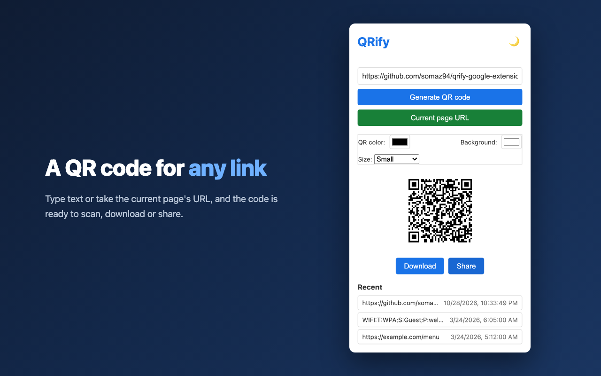

# QRify

A Chrome extension that turns text, the page you are on, or a link, image or selection you right-click into a QR code, in your colors and size.

Every code is drawn in your browser. QRify makes no network requests and keeps nothing but your recent codes and your theme, on your own browser.



<br/>

## Features

- **Any text or URL**, typed in or taken from the current page with **Current page URL**; the code follows as you type, and `Enter` adds it to the recent list
- **Right-click menus** for selected text, a link or an image address; the code opens in a new tab
- **Unicode**: Korean, emoji and any other text are encoded as UTF-8 and scan back exactly
- **Colors and sizes**: pick the code and background colors and one of four sizes, kept for next time; the four-module margin scanners need is always drawn
- **Download** the code as a PNG, or **Share** it through the system share sheet
- **Recent** list of your last codes with their colors and size, one click from reopening; remove one with `×` or all with **Clear all**
- A light and a dark theme that follow the system unless you pick one, and **English and Korean**, following the browser language
- `Ctrl+Shift+Q` (`Cmd+Shift+Q` on macOS) opens the popup

<br/>

## Installation

### From Chrome Web Store
1. Visit [QRify](https://chromewebstore.google.com/detail/qrify/lkencifnlcbcfjdpkooejabmgkmdgpee)
2. Click **Add to Chrome**

### From Source

```bash
git clone https://github.com/somaz94/qrify-google-extension.git
```

1. Open `chrome://extensions/`
2. Turn on **Developer mode**
3. Click **Load unpacked** and select the cloned directory

<br/>

## Usage

1. Click the toolbar icon, or press `Ctrl+Shift+Q`
2. Type text or a URL, or press **Current page URL**
3. The code appears as you type; press `Enter` or **Generate QR code** to keep it in **Recent**. Changing a color or the size redraws it
4. **Download** or **Share** the code, or pick an earlier one from **Recent**

On any page, right-click selected text, a link or an image and pick the QRify entry to open its code in a new tab.

<br/>

## Permissions

| Permission | Why |
|---|---|
| `activeTab` | **Current page URL** reads the address of the tab you are on |
| `contextMenus` | The right-click entries |
| `storage` | The recent list and the last colors and size |

<br/>

## Privacy

QRify keeps your recent codes and your theme in the browser's extension storage, on this browser only, and sends nothing anywhere. See [Privacy](docs/PRIVACY.md).

<br/>

## Documentation

- [Development](docs/DEVELOPMENT.md): local setup, architecture, the QR encoder, tests, translations, publishing
- [Privacy](docs/PRIVACY.md): what is stored and where

<br/>

## License

[MIT](LICENSE)
